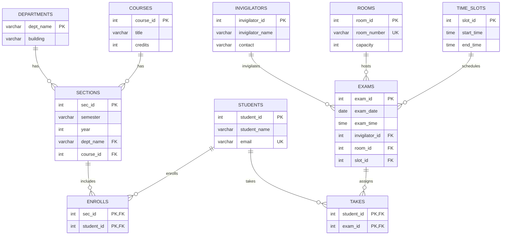

# Examination Management System

A responsive examination-management dashboard built with HTML, CSS, vanilla JavaScript, Express, and MySQL 8. It provides CRUD screens for academic records, manages student-section and student-exam relationships, and checks exam room capacity and scheduling conflicts.

## Features

- CRUD APIs and browser forms for departments, courses, sections, students, exams, invigilators, rooms, and time slots.
- Search for departments, courses, sections, students, invigilators, rooms, and scheduled exams.
- Student enrollment and exam assignment using relational junction tables.
- Capacity validation when assigning students to an exam.
- Exam scheduling checks for room/invigilator conflicts and time-slot boundaries.
- Parameterized SQL values, foreign-key enforcement, centralized API errors, and environment-based credentials.
- SQL seed data, relational query demonstrations, API tests, and opt-in MySQL integration tests.

## Data model



### Relational mapping

- `departments` and `courses` each have a one-to-many relationship with `sections`; their keys are foreign keys on `sections`.
- Student–section and student–exam are many-to-many relationships. `enrolls(sec_id, student_id)` and `takes(student_id, exam_id)` use composite primary keys to prevent duplicate relationships.
- Each exam has one invigilator, one room, and one time slot; the foreign keys are stored on `exams`. A person, room, or time slot may be referenced by multiple exams.
- The prompt's ER diagram was not included with the supplied text. This implementation uses one room per exam and allows a room to host multiple exams at different date/slot combinations.

## Physical schema

`database/schema.sql` creates the `examination_management` database and InnoDB tables, primary/foreign keys, unique constraints, indexes, and MySQL 8.0.16+ `CHECK` constraints for positive credits/capacity and valid slot ranges. `database/seed.sql` inserts sample records. `database/queries.sql` demonstrates joins, aggregates, capacity/slot searches, constraints, and data changes.

The schema deliberately restricts deleting departments, courses, invigilators, rooms, and time slots while they are referenced. Deleting a student or section cascades to its enrollments; deleting a student or exam cascades to its `takes` rows.

## Requirements

- Node.js 18 or newer and npm.
- MySQL 8.0.16 or newer, with an account allowed to create the database and tables.

## Run locally on Windows / PowerShell

1. Install MySQL Server 8 and ensure the MySQL service is running. Open PowerShell in this project directory.
2. Install dependencies and create your local environment file:

   ```powershell
   npm install
   Copy-Item .env.example .env
   notepad .env
   ```

   Set `DB_HOST`, `DB_PORT`, `DB_USER`, `DB_PASSWORD`, and `DB_NAME` in `.env`. Never commit `.env`.
3. Create the schema and seed data (enter your MySQL password when prompted):

   ```powershell
   cmd.exe /c "mysql -u root -p < database\schema.sql"
   cmd.exe /c "mysql -u root -p examination_management < database\seed.sql"
   ```

   Install MySQL Community Server 8.0 (8.0.16 or later) with the Windows MSI if it is not installed, start the MySQL80 service, and add its `bin` directory to PATH. In PowerShell, `cmd.exe /c` is used for SQL file input redirection because PowerShell does not support `< file` redirection.
4. Start the server:

   ```powershell
   npm start
   ```

   Open <http://localhost:3000>. For automatic restarts during development, run `npm run dev`.
5. Run the API tests:

   ```powershell
   npm test
   ```

   Database integration tests are opt-in. After configuring and seeding MySQL, run:

   ```powershell
   $env:RUN_DB_TESTS = "1"
   npm run test:db
   Remove-Item Env:RUN_DB_TESTS
   ```

## REST API

All endpoints are prefixed by `/api`. JSON request bodies are used for create/update operations.

| Resource | Endpoints |
|---|---|
| Departments | `GET/POST /departments`, `GET/PUT/PATCH/DELETE /departments/:id` |
| Courses | `GET/POST /courses`, `GET/PUT/PATCH/DELETE /courses/:id` |
| Sections | `GET/POST /sections`, `GET/PUT/PATCH/DELETE /sections/:id` |
| Students | `GET/POST /students`, `GET/PUT/PATCH/DELETE /students/:id` |
| Exams | `GET/POST /exams`, `GET/PUT/PATCH/DELETE /exams/:id` |
| Invigilators | `GET/POST /invigilators`, `GET/PUT/PATCH/DELETE /invigilators/:id` |
| Rooms | `GET/POST /rooms`, `GET/PUT/PATCH/DELETE /rooms/:id` |
| Time slots | `GET/POST /time-slots`, `GET/PUT/PATCH/DELETE /time-slots/:id` |
| Enrollments | `POST /enrollments`, `DELETE /enrollments/:studentId/:sectionId`, `GET /sections/:id/students` |
| Exam assignments | `POST /exam-assignments`, `DELETE /exam-assignments/:studentId/:examId`, `GET /exams/:id/students` |
| Schedule | `GET /exam-schedule?search=...` |
| Status/metadata | `GET /health`, `GET /metadata` |

List endpoints support `?search=...` where relevant. Example:

```powershell
Invoke-RestMethod http://localhost:3000/api/students
Invoke-RestMethod -Method Post -Uri http://localhost:3000/api/students `
  -ContentType 'application/json' `
  -Body (@{ student_name = 'Demo Student'; email = 'demo@example.edu' } | ConvertTo-Json)
```

Successful creates return `201`, reads/updates return `200`, deletes return `204`, invalid data returns `400`, missing rows return `404`, and conflicts/duplicates return `409`.

## Testing

`npm test` exercises API health, listing, parameterized inserts, and backend validation using a database adapter stub. `npm run test:db` verifies real MySQL seeded queries and duplicate-key enforcement only when `RUN_DB_TESTS=1`. The MySQL integration suite has not been run in an environment without MySQL credentials/server.

## Deployment

`render.yaml` describes the Node web service, but Render does not provide a persistent MySQL database in the web service. Provision a managed MySQL 8 database from a provider that permits your web service to connect (for example, a MySQL-compatible managed database), then configure the Render service variables `DB_HOST`, `DB_PORT`, `DB_USER`, `DB_PASSWORD`, and `DB_NAME`. Apply `database/schema.sql` and `database/seed.sql` to that database before opening the deployed site. Use TLS database options if required by the selected provider; do not commit credentials. Confirm `/api/health` reports `database: connected`.

No repository has been pushed and no website deployed from this workspace. GitHub CLI is not installed here; after creating a GitHub repository, use:

```powershell
git init
git add .
git commit -m "Build examination management system"
git branch -M main
git remote add origin https://github.com/YOUR-USERNAME/examination-management-system.git
git push -u origin main
```

Replace the remote with the actual repository URL. Git credentials are handled by Git Credential Manager; never put a token in a remote URL.

## Screenshots

Add screenshots of the dashboard, CRUD forms, and schedule here after running the application.

## DBMS viva notes

- **ER diagram:** entities model departments, courses, sections, students, exams, invigilators, rooms, and time slots. Relationships specify cardinality.
- **Relational schema:** each entity becomes a table. A one-to-many relationship is represented by a foreign key on the many-side.
- **Many-to-many:** `enrolls` and `takes` are junction relations. Composite primary keys ensure each student-section or student-exam pair appears at most once.
- **Physical schema:** MySQL types, InnoDB, indexes, constraints, and referential actions implement the logical model.
- **Primary keys** uniquely identify a tuple; **foreign keys** ensure a referenced parent exists. Unique email prevents duplicate student email addresses.
- **Normalization:** relationships are stored once and linked by keys instead of repeating department, course, or student details in exam/enrollment rows.
